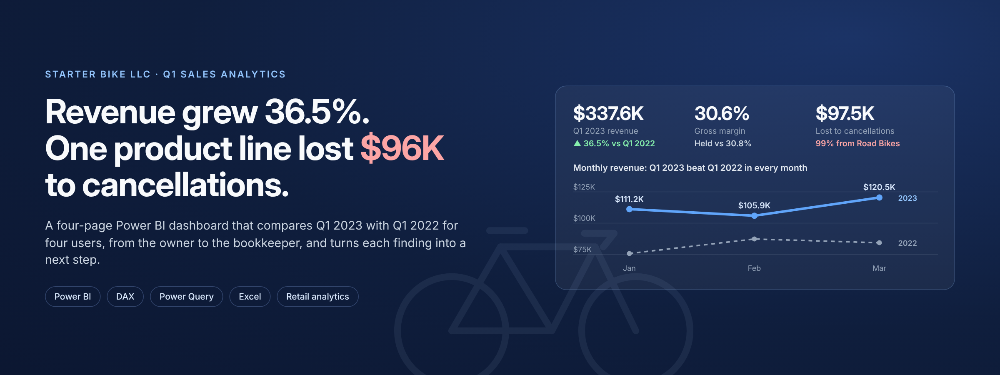

<h1 align = "center"> 
Starter Bike LLC Sales Analytics Dashboard 
Project Charter
</h1>

## Background

Starter Bike LLC (a fictional company) is a bicycle retailer that sells various types of bicycles to its emerging consumer niche. Having just completed its annual operations for the second year running, company executives demand that consolidated transactional data, including recorded transactional sales data, product information, pricing details, quantities sold, order status, and sales dates, be utilized  to design a data-driven sales drive. However, although operational data is readily available, the executives still lacks a centralized reporting solution that can transform available raw information into meaningful business insights.

The company executives believe that an analytical dashboard can help decision-makers spend considerably less time compiling reports manually, making it a little simpler to identify revenue drivers, evaluate product performance, monitor operational efficiency, and estimate tax obligations. 

Therefore, this project is intended to transform the company's transactional sales data into an interactive Business Intelligence solution using Microsoft Power BI.

## Business Problem

While Starter Bike LLC generates sales every day, company executives still lack visibility into overall business performance.

Management cannot easily answer critical operational questions such as:

- Which products contribute the most to revenue?
- Which product categories are the most profitable?
- How much tax liability has the business incurred?
- Which products trigger the highest tax expense?
- How are sales changing over time?
- Which orders are successfully completed versus cancelled?
- Where are operational inefficiencies occurring?

Without these insights, management believe the business risks relying on decisions based on assumptions rather than evidence.

## Business Context

As a company governed by financial tax laws, Starter Bike LLC operates under the following tax rule:

Any individual order line whose value exceeds $2,000 attracts a 5% sales tax. The tax is added to the customer's bill, collected by the company and remitted to the Internal Revenue Service (IRS). It is not company revenue and not a business expense, so it doesn't reduce revenue or profit. Lines valued at $2,000 or below are exempt.

## Project Goal

To design and develop an interactive Power BI dashboard that will enable Starter Bike LLC executives to monitor sales performance, product performance, operational efficiency, and tax obligations while supporting evidence-based business decision-making.

## Project Objectives

The dashboard will enable management to monitor:

### Sales Performance
- Total revenue generated.
- Sales trends over time.
- Order value and order volumes.

### Product Performance
- Top-performing products.
- Comparison between product categories.
- Product profitability.
- Product contribution to total revenue.

### Operational Performance
- Order status distribution.
- Cancellation of orders.
- Operational efficiency.
- Products with high risk of cancellation.

### Tax Analysis
- Tax liability.
- Customer billings (revenue plus tax collected).
- Tax contribution by product and category.

### Executive Reporting

Provide an interactive dashboard allowing executives to filter results by:

- Year (every page, compared with the prior year)
- Month (Products & Margins)
- Payment method (Overview, Orders & Cancellations, Tax)

## Scope

This project include documentation of:

- Data cleaning and transformation using Power Query
- Data modeling
- DAX calculations
- Interactive dashboard development
- KPI development
- Executive reporting
- Tax calculations

## Success Criteria

The project is considered successful if it delivers:

- An interactive Power BI dashboard
- Accurate tax calculations
- Executive KPI page
- Payment-method analysis (on the Products & Margins page)
- Operational dashboard
- Product performance dashboard
- Fully documented GitHub repository
- Reproducible workflow

## Deliverables

- A Clean dataset
- Data dictionary
- Power Query documentation
- Data model documentation
- DAX measures documentation
- Power BI dashboard
- Executive summary
- GitHub repository

## Risks

- Missing values: Mitigated by data cleaning procedures
- Duplicate orders: Mitigated by duplicate detection
- Incorrect data types: Mitigated by data validation
- Inconsistent customer information: Mitigated by standardization
- Tax calculation errors: Mitigated by validation against business rules

## Assumption

1. Dataset represents completed business transactions.
2. Customer IDs uniquely identify customers.
3. Order IDs uniquely identify orders.
4. Product prices are accurate.
5. Tax is calculated using the pre-tax value of each fulfilled order line.

## Business Rule

Sales Tax Rule

If an order value surpasses $2000, then the product sales attracts a tax of 5%. Otherwise the sales tax is 0%

The tax is imposed on the customer but does not constitute company revenue as it is remitted to the IRS by the company.

## Outcome

Delivered as a four-page Power BI dashboard (Executive Overview, Products & Margins, Orders & Cancellations, Tax). Each page answers one [decision question](Business_questions.md) for one user. Results and recommendations are in the [README](../README.md) and [Insights](../04_reports/Insights.md).

Changes from this charter:
- **Customers:** customer analytics was dropped, because the Customer and Order IDs don't identify individual purchases ([data audit](Data_audit_report.md)). Payment-method analysis is covered instead.
- **Tax:** "net revenue after tax" was replaced with customer billings, in line with the sales tax rule above.
