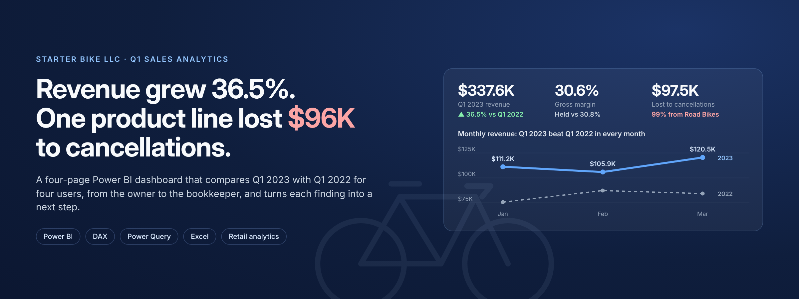
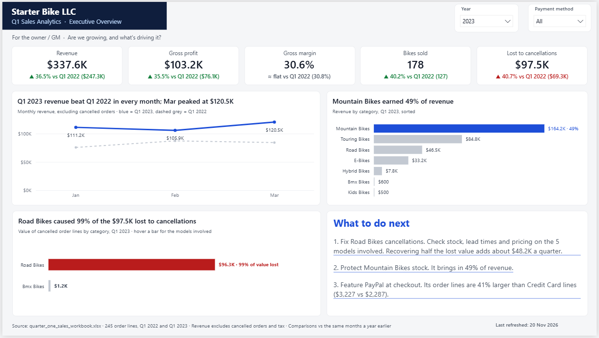
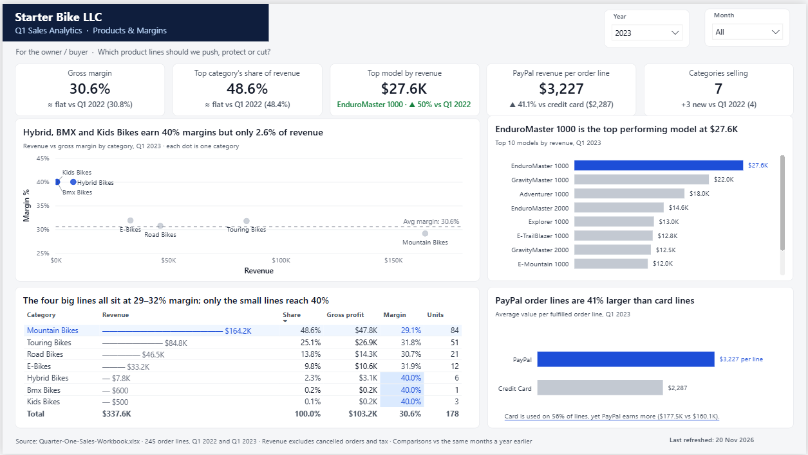
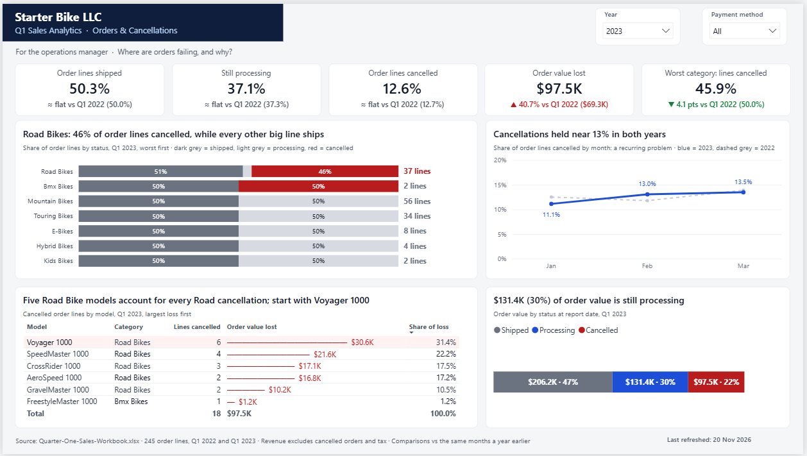
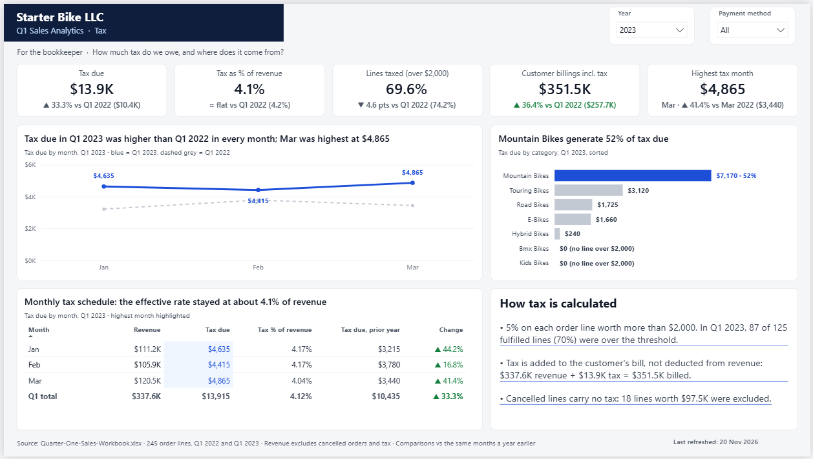

<h1 align="center">
Starter Bike LLC Retail Sales Analytics
</h1>

<p align="center">
  
</p>

<p align="center">
<b>A 4-page Power BI dashboard for a bike retailer. It shows revenue up 36.5% year on year, and traces 99% of the order value lost to cancellations ($96.3K) to a single product line: Road Bikes.</b>
</p>

| Revenue (Q1 2023) | vs Q1 2022 | Gross profit | Bikes sold | Order value lost to cancellations | Of that, from Road Bikes |
|:---:|:---:|:---:|:---:|:---:|:---:|
| **$337.6K** | **▲ 36.5%** | **$103.2K** (30.6% margin) | **178** (▲ 40.2%) | **$97.5K** (▲ 40.7%) | **99%** |

**Tools:** Power BI (PBIP project) · Power Query · DAX · Excel

**Quick read:** [one-page project summary (PDF)](04_reports/Starter_Bike_Project_Summary.pdf) · [slide deck (PPTX)](04_reports/Starter_Bike_Q1_Sales_Analytics.pptx) · [full insights](04_reports/Insights.md)

---

## Business question → insight → recommended action

| Business question | Insight | Recommended action |
|---|---|---|
| **Are we growing, and what's driving it?** | Q1 revenue rose 36.5% to $337.6K and beat Q1 2022 in every month. Mountain Bikes earned 49% of it. | Protect Mountain Bike stock and supplier terms ahead of next Q1. Half of revenue depends on one line. |
| **Where are we losing money?** | 46% of Road Bike order lines were cancelled: $96.3K of the $97.5K lost. Five models account for all of it, led by Voyager 1000 ($30.6K). Road Bikes were the only category with cancellations in Q1 2022 too. | Audit stock, lead times and pricing on the five Road Bike models, starting with Voyager 1000. Recovering half the lost value adds about $48K a quarter. |
| **Which product lines and customers should we grow?** | PayPal order lines are 41% larger than card lines ($3,227 vs $2,287). Hybrid, BMX and Kids Bikes earn 40% margins but bring in only 2.6% of revenue. | Feature PayPal at checkout. Test whether the high-margin small lines can grow before cutting them. |
| **How much tax do we owe?** | Tax due is $13,915 (4.1% of revenue), up 33.3% with sales. Mountain Bikes generate 52% of it, and March was the highest month ($4,865). | Set aside about 4% of Q1 revenue for remittance. Tax is collected from customers on top of the price, so it does not reduce profit. |

---

## 1. The problem

> *"The client had two years of first-quarter sales sitting in a spreadsheet. Every time leadership asked which products made money, why orders got cancelled, or how much tax was owed, someone built the report by hand. The client needed one dashboard that answered those questions in seconds and kept working as the business grows."*

Starter Bike LLC (a fictional retailer) needed a single place to track revenue drivers, product profitability, order fulfilment and tax liability.

## 2. The data

| | |
|---|---|
| **Source** | Internal sales system export ([`quarter_one_sales_workbook.xlsx`](02_data/quarter_one_sales_workbook.xlsx)) |
| **Size** | 245 order lines × 15 fields, plus 8 calculated columns in the model |
| **Time range** | Q1 2022 (Jan–Mar, 102 lines) and Q1 2023 (Jan–Mar, 143 lines) |
| **Contents** | Product, category and subcategory, wholesale and retail price, quantity, payment method, order status, customer and order IDs |

Audit result: no missing values and no invalid quantities. One header (`Product Category`) had a trailing space, which is trimmed on import. One line priced below wholesale and two possible duplicate lines are flagged and kept as recorded; together they affect under 2% of revenue ([audit report](01_docs/Data_audit_report.md), [cleaning report](01_docs/Data_cleaning_report.md)).

## 3. Approach

1. **Scoping.** Wrote a [project charter](01_docs/Project_charter.md) and [business requirements](01_docs/business_requirement_document.md). Narrowed them to [four decision questions](01_docs/Business_questions.md), one per dashboard page, each for a named user.
2. **Data audit and cleaning.** Profiled every field and checked data types, duplicates, identifiers and invalid values ([data dictionary](01_docs/Data_dictionary.md), [data profile](01_docs/Data_profile_summary.md), [quality checklist](01_docs/Data_quality_checklist.md)).
3. **Transformation and modelling.** Trimmed headers and set types in Power Query, and parameterised the data folder. Added Revenue, Profit, Tax Due, Customer Bill and Order Value columns, plus a marked Date table for prior-year comparisons ([ETL log](04_reports/ETL%20log.md), [calculated columns](03_DAX/Calculations.md)).
4. **DAX.** About 180 measures in 8 display folders. They cover core figures, prior-year comparisons with ▲▼ labels, insight titles that rewrite themselves when the slicers change, and conditional formatting that highlights one item per chart ([measures](03_DAX/Measures.md)).
5. **Dashboard design.** Built to a written design guide; see [Design principles](#5-design-principles) below.

## 4. The dashboard

Each page answers one question for one user. Slicers sit in the same top-right spot on every page, and every figure is compared with the same months a year earlier.

| Page | For | Question it answers |
|---|---|---|
| **Executive Overview** | Owner / GM | Are we growing, and what's driving it? |
| **Products & Margins** | Owner / buyer | Which product lines should we push, protect or cut? |
| **Orders & Cancellations** | Operations manager | Where are orders failing, and why? |
| **Tax** | Bookkeeper | How much tax do we owe, and where does it come from? |

<p align="center">
  
</p>

<details>
<summary><b>Products & Margins</b></summary>
<br>
<p align="center"></p>
</details>

<details>
<summary><b>Orders & Cancellations</b></summary>
<br>
<p align="center"></p>
</details>

<details>
<summary><b>Tax</b></summary>
<br>
<p align="center"></p>
</details>

The full findings, page by page, are in [Insights](04_reports/Insights.md).

## 5. Design principles

- **Start from the decision.** Four users, four questions, one page each. Every visual answers its page's question; visuals from the first version that didn't, such as the decomposition trees, payment donuts and photo backgrounds, were removed.
- **Visual hierarchy.** KPI cards across the top, each with a ▲▼ comparison to the prior year. Trends below them, and breakdowns and detail tables at the bottom, following the Z-pattern.
- **Restraint.** Six visuals or fewer per page. One accent colour (blue) for "look here", grey for everything else. Red and green only for bad and good, never for decoration. No pie charts, gauges or photo backgrounds.
- **The right chart for each job.** Lines for trends, sorted bars for comparisons, a scatter for revenue vs margin, stacked bars for parts of a whole, and tables with highlights for exact values.
- **Titles that state the insight.** For example, "Road Bikes caused 99% of the $97.5K lost to cancellations", not "Cancelled value by category". The titles are DAX measures, so they stay true when the slicers change.
- **Polish.** One font family, numbers formatted as $337.6K rather than 337,600.00, and a "last refreshed" date and data source on every page.

## 6. Recommendations

1. **Fix Road Bike cancellations first.** Almost all lost order value comes from five Road Bike models, and the problem recurred in both years. Start with Voyager 1000 (31% of the loss). Recovering half the lost value adds about $48K a quarter.
2. **Protect the Mountain Bike line.** It brings in 49% of revenue and 52% of tax due, so prioritise its stock levels and supplier terms.
3. **Lean into PayPal.** PayPal buyers place larger order lines. Featuring PayPal at checkout, or targeting promotions at PayPal customers, could raise the average order line value.
4. **Decide on the small lines.** Hybrid, BMX and Kids Bikes have the highest margins (40%) but contribute only 2.6% of revenue. Test whether they can grow before cutting them back.
5. **Clear the processing backlog.** $131.4K (30%) of Q1 2023 order value was still processing at report date. Track it monthly so it doesn't turn into more cancellations.
6. **Use the dashboard as the monthly reporting pack.** It replaces manual reporting, and adding a new quarter only needs a refresh.

---

## How to run

**Requirements:** [Power BI Desktop](https://powerbi.microsoft.com/desktop/) (free, Windows), a recent version that opens Power BI Project (`.pbip`) files.

1. Clone or download this repository.
2. Open [`04_reports/starter-bike-sales-analytics-dashboard.pbip`](04_reports/starter-bike-sales-analytics-dashboard.pbip).
3. Go to **Transform data → Edit parameters**. Set **Data Folder** to the full path of this repo's `02_data\` folder on your machine, including the trailing backslash.
4. Click **Refresh**. The data isn't stored in the repo, so the pages stay empty until the first refresh.

### Repository structure

```
starter-bike-sales-analytics/
├── 01_docs/                     Project charter, business requirements, business questions,
│                                data audit, cleaning report, data dictionary, profile, quality checklist
├── 02_data/                     Source workbook (quarter_one_sales_workbook.xlsx)
├── 03_DAX/                      Measures.md (all measures by folder) and Calculations.md (calculated columns and tables)
├── 04_reports/
│   ├── starter-bike-sales-analytics-dashboard.pbip        Open this in Power BI Desktop
│   ├── starter-bike-sales-analytics-dashboard.Report/      Report pages and visuals (PBIR)
│   ├── starter-bike-sales-analytics-dashboard.SemanticModel/  Data model and DAX (TMDL)
│   ├── ETL log.md               Power Query and model steps
│   ├── Insights.md              Findings and recommendations, page by page
│   ├── Starter_Bike_Q1_Sales_Analytics.pptx               9-slide deck
│   ├── Starter_Bike_Project_Summary.pdf                   One-page summary for clients
│   └── figures/                 Dashboard screenshots, cover, thumbnail, social preview
├── LICENSE
└── README.md
```

---

**Have a similar problem on your hands?** Invite me to work on [Upwork](https://www.upwork.com/freelancers/uv23o9) · Reach out on [LinkedIn](https://www.linkedin.com/in/vince-okumu23/) · Or email me at vinny.otieno23@gmail.com

**Vincent Okumu**
