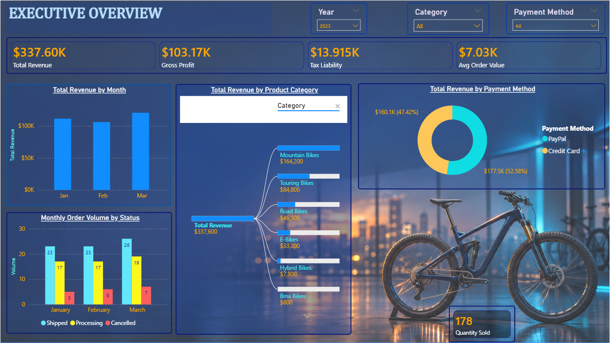
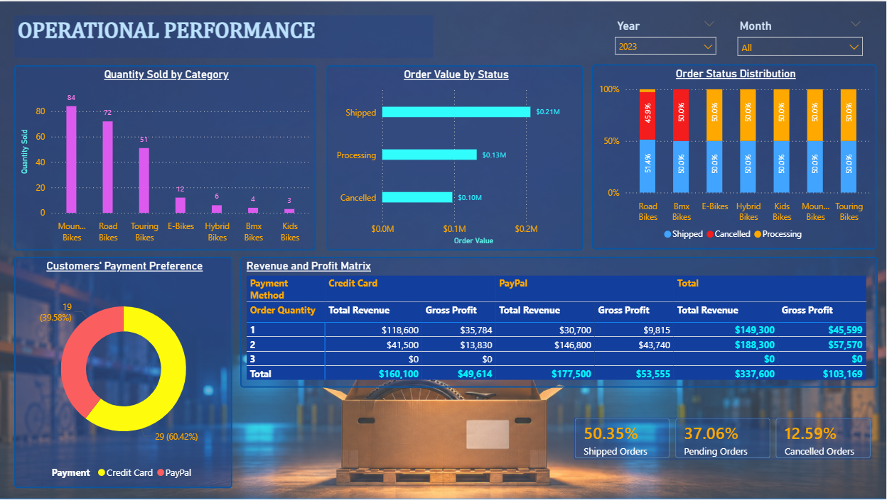
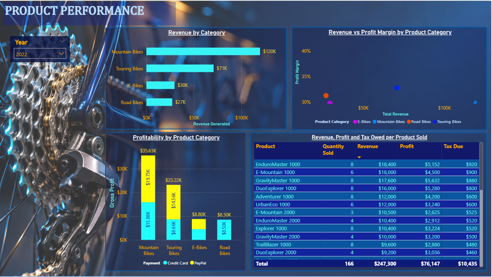
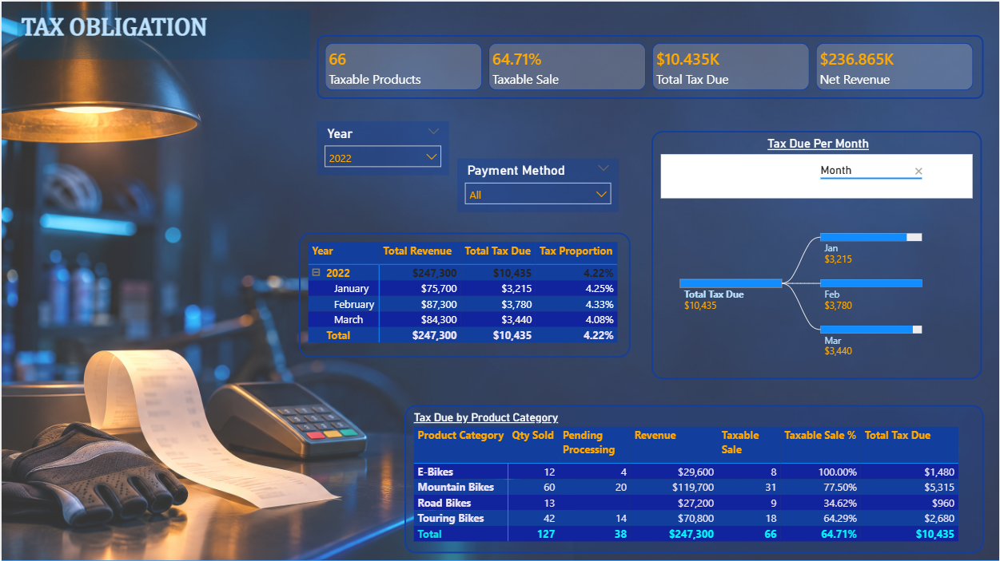

<h1 align ="center">
Bike Retailer Sales Analytics
</h1>

<p align="center">
  
</p>

<p align="center">
<b> A 4-page Power BI dashboard for a bike retailer that showed revenue up 36% year on year, and traced 99% of lost order value ($96K) to a single product line: Road Bikes.</b>
</p>

| Revenue (Q1 2023) | Growth vs Q1 2022 | Gross profit | Order value lost to cancellations | Of that, from Road Bikes |
|:---:|:---:|:---:|:---:|:---:|
| **$337.6K** | **+36.5%** | **$103.2K** (30.6% margin) | **$97.5K** (22% of all orders) | **99%** |

**Tools:** Power BI · Power Query · DAX · Excel

---

## 1. The problem

> *"Client had two years of first-quarter sales sitting in a spreadsheet, but every time leadership asked which products made them money, why orders got cancelled, or how much tax was owed, someone had to build the report by hand. Client needed one dashboard that answered those questions in seconds, and that would keep working as they grow."*

Starter Bike LLC (a fictional retailer) needed a single place to track revenue drivers, product profitability, order fulfilment and tax liability.

## 2. The data

| | |
|---|---|
| **Source** | Internal sales system export ([`Quarter-One-Sales-Workbook.xlsx`](04_Data/Quarter-One-Sales-Workbook.xlsx)) |
| **Size** | 245 order lines × 15 fields (plus 6 calculated columns) |
| **Time range** | Q1 2022 (Jan–Mar) and Q1 2023 (Jan–Mar) |
| **Contents** | Product, category and subcategory, wholesale and retail price, quantity, payment method, order status, customer and order IDs |

Audit result: no missing values, no duplicate orders, no invalid prices or quantities ([audit report](04_Data/data_audit_report.md)).

## 3. Approach

1. **Scoping.** Wrote a [project charter](01_Project_Charter/project_charter.md) and [business requirements](02_Business_Requirements/business_requirement_document.md), and turned them into [40+ business questions](03_Documentation/Business%20Questions.md) grouped by theme.
2. **Data audit and cleaning.** Profiled every field, checked data types, duplicates and invalid values ([cleaning report](03_Documentation/Data%20Cleaning%20Report.md), [data dictionary](03_Documentation/Data%20Dictionary.md)).
3. **Transformation in Power Query.** Added Revenue, Profit, Tax Due (5% on order lines above $2,000), Customer Bill and Tax Proportion columns ([ETL log](05_Reports/ETL%20log.md)).
4. **Modelling in DAX.** Built 18 measures, including revenue net of cancellations, fulfilment rates, average order value and taxable-sales share ([measures](07_DAX/Measures.md)).
5. **Dashboard design.** Four report pages (Executive Overview, Product Performance, Operational Performance, Tax Obligation), with slicers for year, month, category and payment method.

## 4. Results

**Growth.** Q1 revenue rose from $247.3K (2022) to **$337.6K (2023), up 36.5%**. Gross profit rose 35.5% to $103.2K, and margin held steady at about 31%. Paying customers grew from 28 to 42.

**One category drives half the business.** Mountain Bikes brought in **$164.2K, 49% of revenue**, and the most profit ($47.8K). Mountain and Touring Bikes together made up 74% of revenue. The best-selling model was EnduroMaster 1000 ($27.6K).

**Cancellations are concentrated in one product line.** 46% of Road Bike order lines were cancelled, while every other major category had none. Road Bikes accounted for **$96.3K of the $97.5K** in cancelled order value. Road Bikes were also the only cancelled category in Q1 2022, so this is a recurring problem rather than a one-off.

**PayPal customers spend more.** Credit cards were used by 60% of customers, but PayPal brought in more revenue ($177.5K vs $160.1K). PayPal order lines were worth 41% more on average ($3,227 vs $2,287).

**Tax.** Total tax due for Q1 2023 was **$13,915**, about 4.1% of revenue.

<p align="center">
  
</p>

<p align="center">
  
</p>

<details>
<summary><b>See the other two dashboard pages</b></summary>
<br>

**Product Performance**: revenue and profit by category, subcategory and model
<p align="center"></p>

**Tax Obligation**: taxable sales, tax due by month and category (screenshot filtered to PayPal orders)
<p align="center"></p>

</details>

## 5. Recommendations

1. **Investigate Road Bike cancellations first.** Almost all lost revenue comes from them. Check stock availability, delivery lead times and pricing on Road Bike models. Recovering half of the cancelled value would add about $48K a quarter.
2. **Protect the Mountain Bike line.** Half of revenue depends on it, so prioritise its stock levels and supplier terms ahead of Q1.
3. **Lean into PayPal.** PayPal buyers place larger orders. Featuring PayPal at checkout, or targeting promotions at those customers, could raise average order value.
4. **Review the smaller categories.** BMX, Kids and Hybrid Bikes have the highest margins (40%) but contribute under 3% of revenue. Decide whether to grow them or cut them back.
5. **Make the dashboard the monthly reporting pack.** It replaces manual reporting and scales as new quarters are added.

---

## How to run

**Requirements:** [Power BI Desktop](https://powerbi.microsoft.com/desktop/) (free, Windows).

1. Clone or download this repository.
2. Open [`05_Reports/starter-bike-sales-analytics-dashboard.pbix`](05_Reports/starter-bike-sales-analytics-dashboard.pbix).
3. If prompted, go to **Transform data → Data source settings** and point the source to `04_Data/Quarter-One-Sales-Workbook.xlsx` on your machine, then click **Refresh**.

### Repository structure

```
starter-bike-sale-analytics/
├── 01_Project_Charter/        Scope, objectives, stakeholders
├── 02_Business_Requirements/  Business requirements document
├── 03_Documentation/          Business questions, data dictionary, cleaning report
├── 04_Data/                   Raw workbook + data audit and quality checks
├── 05_Reports/                Power BI file (.pbix) + ETL log
├── 07_DAX/                    DAX measures and calculated columns
├── 08_Images/                 Dashboard screenshots
├── LICENSE
└── README.md
```

---

**Have a similar problem on your hands?** Invite to work on [Upwork](https://www.upwork.com/freelancers/uv23o9) · Reach out via [LinkedIn](https://www.linkedin.com/in/vince-okumu23/) · Or email me at vinny.otieno23@gmail.com

**Vincent Okumu**
